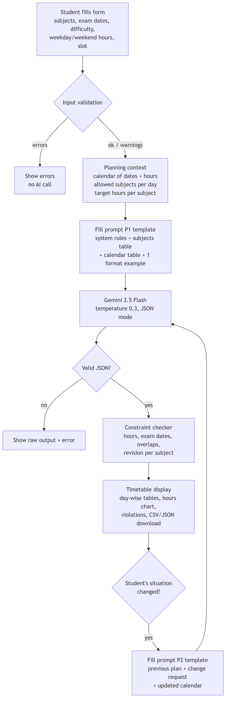
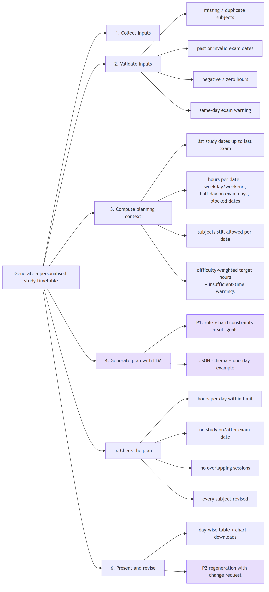
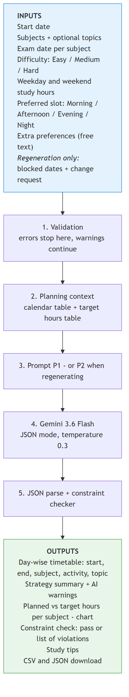
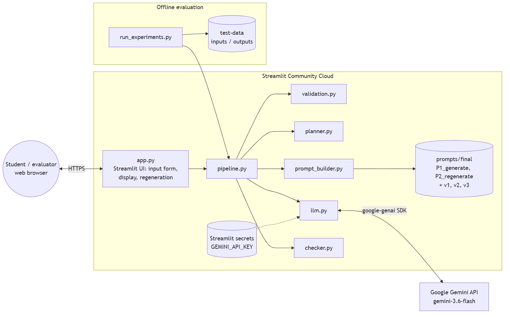
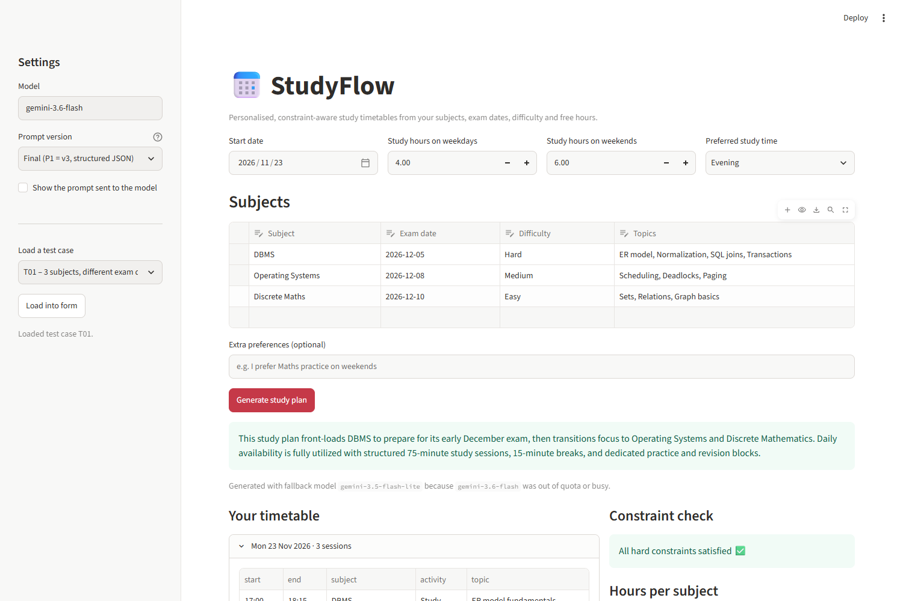
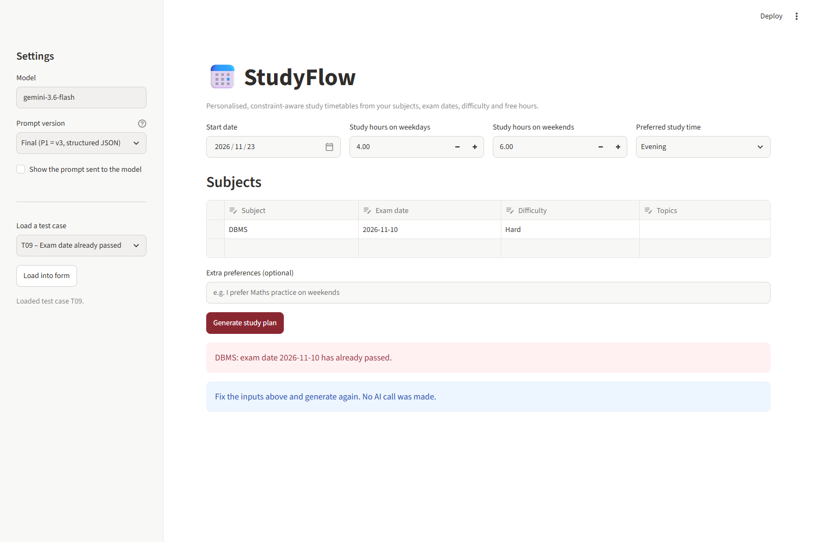
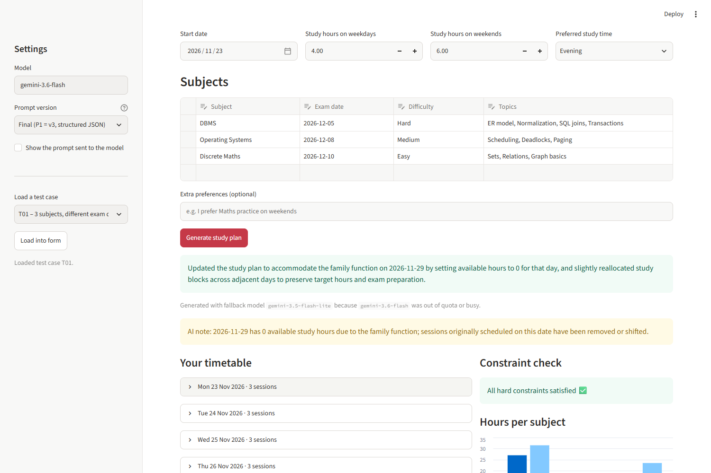
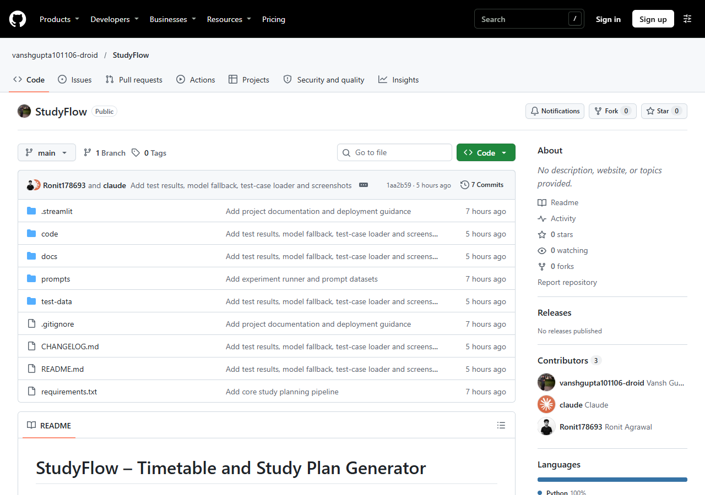

<!-- Edit this file, then run:  python docs/build_report.py
     Everything inside {{...}} is filled automatically from /prompts and /test-data/outputs.
     Search for FILL markers and replace every one before submitting. -->

## 1. Cover page

# StudyFlow
### Timetable and Study Plan Generator
**SCSE4041 Prompt Engineering – Mini Project · Milestone 2**

| | |
|---|---|
| **Team ID** | PE-B13-15 |
| **Team name** | CodeHead |
| **Project title** | Timetable and Study Plan Generator |
| **Problem ID / source** | C20 – Problem Pool |
| **Batch** | B13-24 |
| **Faculty** | Dr. Indrajeet Gupta |

| Member | Enrollment no. |
|---|---|
| Ronit Agrawal (Team Leader) | S24CSEU1323 |
| Vansh Gupta | S24CSEU1338 |
| Mehul Choubey | S24CSEU1324 |

| Link | URL |
|---|---|
| Prototype | https://studyflowgit-7qknfdiszryc4rcjjw8ya2.streamlit.app/ |
| Repository | https://github.com/vanshgupta101106-droid/StudyFlow |
| Reel | https://drive.google.com/file/d/14i-Newnsk6OVFfegpspNiwRQwr__BSrZ/view?usp=drivesdk |

## 2. Prompt and solution design

### 2.1 Design summary
**Problem and users.** College students preparing for several exams find it hard to split limited study time across subjects with different difficulty levels and exam dates. Asking a general chatbot gives plans that ignore their real constraints: too many hours on a day, a subject scheduled after its exam, or no revision. StudyFlow is for students who want a realistic day-wise plan they can trust.

**Input and output.** The student enters a start date, their subjects (with optional topics), each exam date, each subject's difficulty (Easy/Medium/Hard), study hours on weekdays and weekends, a preferred time slot and optional preferences. StudyFlow returns a day-wise timetable (time, subject, activity – Study / Practice / Revision / Break – and topic), a strategy summary, warnings, planned-vs-target hours per subject, a pass/fail constraint check and a CSV/JSON download. The plan can then be regenerated after a change, such as blocked dates or a new request.

**How many prompts and steps, and why.** The workflow has 5 steps. 3 of them are code and 2 are LLM prompts:

1. **Validation (code):** rejects impossible inputs before any LLM call is made.
2. **Planning context (code):** computes every study date, the hours available on it, the subjects still allowed, and difficulty-weighted target hours. Our tests showed that LLMs make date and arithmetic mistakes, so this is done in code.
3. **P1 – generate (LLM):** creates the schedule from these tables.
4. **Constraint checker (code):** verifies the result.
5. **P2 – regenerate (LLM):** revises an existing plan.

P2 is a separate prompt because it needs the previous plan and a change request as extra inputs.

**Tool and model, and why.** We use **Gemini 3.6 Flash through the Gemini API (Google AI Studio key)**, called from a Streamlit web app. We chose it for four reasons:

- It has a free API tier, which an evaluator-facing prototype needs.
- Its native JSON response mode makes the output reliably machine-checkable.
- It is fast enough for interactive use (one plan in a few seconds).
- It was one of the three tools we shortlisted in Milestone 1 and is simple to deploy on Streamlit Community Cloud.

**What changed since Milestone 1.** In Milestone 1 we defined the problem, the idea and three candidate AI tools (ChatGPT, Gemini, Claude). Since then we have:

- selected one model (Gemini 3.6 Flash);
- designed the code + LLM task decomposition above;
- written and tested three prompt versions;
- built and deployed the working app with validation, an automatic constraint checker and regeneration;
- tested it on 12 inputs.

### 2.2 Diagrams
All diagrams were drawn by the team for this implementation (Mermaid sources in `docs/diagrams/`). StudyFlow does not use agents or retrieval (RAG), so those diagrams are not applicable.

*Figure A – Prompt workflow*

*Figure B – Task decomposition (purple = done by the LLM, others = code)*

*Figure C – Input–output flow*

*Figure D – System architecture*

### 2.3 Prompt sheets
The final solution uses **2 prompts**: P1 (generate) and P2 (regenerate).

{{PROMPT_SHEETS}}

## 3. Implementation

### 3.1 What is built
StudyFlow is a Python web application built with Streamlit (`code/application/`), deployed on Streamlit Community Cloud. It calls Gemini 3.6 Flash through the official `google-genai` SDK. The API key is stored in Streamlit secrets and never in the repository. The web app and the test runner share the same pipeline, so the tests exercise exactly the code the user runs.

| Module | What it does | Status | Notes |
|---|---|---|---|
| Student Input Module | Form for start date, hours, slot, preferences and an editable subjects table | Working | `app.py` |
| Input Validation Module | Blocks missing subjects, past dates, negative/zero hours and duplicates; warns about same-day exams and low hours | Working | `validation.py`; covered by unit tests; tests T09–T11 |
| Prompt Engineering Module | Builds the date calendar and target hours, then fills the saved prompt templates | Working | `planner.py`, `prompt_builder.py`, `prompts/` |
| AI Study Plan Generator | Calls Gemini with prompt P1 in JSON mode, with retries | Working | `llm.py`, `pipeline.py`; 8/8 valid-input tests gave valid JSON (Section 4). Falls back to another Gemini Flash model if the free daily quota runs out |
| Constraint Checker | Checks daily hours, exam dates, overlaps and revision for every subject | Working | `checker.py`; result shown in the app |
| Timetable Display Module | Day-wise tables, planned-vs-target hours chart, warnings, CSV/JSON download | Working | `app.py` |
| Revision and Break Management | Revision before every exam, breaks between sessions, practice for harder subjects | Working | Rules in P1; revision verified by the checker |
| Regeneration Module | Re-plans after blocked dates or a change request, using P2 | Working | Test T12: Sunday 29 Nov removed, 0 violations |

### 3.2 Prompt iteration log
These are saved versions of prompt P1. The final P1 is v3. P2 is a separate prompt (see Section 2.3). Each result comes from running the version several times on the same inputs; see `test-data/outputs/prompt_comparison.md`.

| Version | What changed | Why it was changed | Result after the change |
|---|---|---|---|
| v1 | First prompt: subject names only. No role, no dates, no hours, default temperature (1.0), free-text output | Starting point | {{ITER_v1}} |
| v2 | Added a planner role, start date, exam dates, difficulty, weekday/weekend hours, preferred slot and 3 rules; markdown table output; temperature 0.7 | v1 ignored the student's real dates and hours | {{ITER_v2}} |
| v3 (final) | Expert role; hard constraints separated from soft goals; pre-computed availability calendar and target hours; mandatory revision and breaks; 1 format example; strict JSON schema; temperature 0.3 | v2 output was free text that could not be checked, and the model had to do date arithmetic itself | {{ITER_v3}} |

**Same inputs, all versions (counts from the saved runs):**

{{PROMPT_COMPARISON}}

**What we observed:** v1 never used the student's real start date (0/4 runs) and invented its own budget, for example a "7-Day Intensive Sprint Plan assuming 5 to 6 hours of study per day" when the student had 4 h on weekdays and 6 h on weekends. v2 used the real dates and hours in 3/3 runs, but its markdown tables could not be checked automatically, so a hidden mistake could not be detected. v3 returned valid JSON with 0 constraint violations in 3/3 runs, and the final P1 then passed all 8 valid-input tests in Section 4. The T06 comparison runs (8 of the planned 18) failed with the free-tier daily quota error (HTTP 429). These are API failures, not prompt results, so they are excluded from the counts and kept in `test-data/outputs/` as evidence.

**Full text of each version:**

{{PROMPT_VERSIONS}}

## 4. Demonstration and testing

### 4.1 Test table
{{RESULTS_TABLE}}

A valid input passes only if the output is valid JSON **and** the automatic constraint checker finds 0 violations. An invalid input passes only if it is rejected before any AI call. The full inputs are in `test-data/inputs/` and the saved outputs in `test-data/outputs/final/`. Failed tests are reported as they happened.

### 4.2 Screenshots of real runs
These were taken from the running app on 22 Nov 2026. The free daily quota of `gemini-3.6-flash` had been used up by the test run, so the app's automatic fallback answered with `gemini-3.5-flash-lite`, as shown on screen.

*Screenshot 1 – Test T01: day-wise plan for DBMS, OS and Discrete Maths; all hard constraints satisfied; planned vs target hours per subject*

*Screenshot 2 – Test T09: past exam date rejected by validation, no AI call made*

*Screenshot 3 – Test T12: plan regenerated after blocking Sunday 29 Nov; sessions moved, 0 violations*

### 4.3 Known limitations and what we will try next
| # | Limitation | What we will try next |
|---|---|---|
| 1 | The LLM can still break a hard constraint. The checker reports it but does not fix it. | Add a repair step that sends the checker's violations back to the model (max 2 retries). |
| 2 | The free Gemini tier allows only 20 requests per model per day. During testing it ran out, and 8 of 18 comparison runs failed with HTTP 429. The app now falls back to other Gemini Flash models, but a fallback model can give slightly different plans. | Cache identical requests, show a retry timer, and re-run the full comparison on a fresh daily quota. |
| 3 | Plans are not saved between sessions. | Add calendar (.ics) export and optional saved plans. |
| 4 | Without topics, session topics are generic because the app does not know the syllabus. | Let students upload or paste the syllabus and split topics from it. |

## 5. Repository

**Link:** https://github.com/vanshgupta101106-droid/StudyFlow

*Repository home page (public, 22 Nov 2026)*

**What changed since Milestone 1:**
- Built and deployed the StudyFlow Streamlit app with 8 modules (Section 3.1).
- Saved 3 prompt versions (`prompts/v1–v3`) and 2 final prompts (`prompts/final/`).
- Added an automatic constraint checker, offline unit tests and an experiment runner.
- Ran 12 test inputs and a v1/v2/v3 comparison; all inputs and outputs are saved in `test-data/`.
- Added diagrams, this report and a dated `CHANGELOG.md`.

## 6. Supporting document

{{TECH_REPORT}}

## 7. Team contribution

| Member name | Enrollment no. | Role | Tasks done in Milestone 2 | Evidence | Contribution (%) |
|---|---|---|---|---|---|
| Ronit Agrawal | S24CSEU1323 | Team leader, prompt design | Wrote prompt P1 v1–v3 and P2; built the prompt builder and the shared pipeline; ran the prompt comparison; compiled this report | `prompts/v1–v3/`, `prompts/final/P1_generate.txt`, `P2_regenerate.txt`, `prompt_builder.py`, `pipeline.py`; Sections 2–3 | 35 |
| Vansh Gupta | S24CSEU1338 | Backend logic and testing | Built input validation, the planning context (calendar + target hours) and the constraint checker; wrote the 12 test inputs, unit tests and experiment runner | `validation.py`, `planner.py`, `checker.py`, `tests/test_core.py`, `test-data/inputs/T01–T12`, `run_experiments.py`; Section 4 | 35 |
| Mehul Choubey | S24CSEU1324 | Frontend, deployment and documentation | Built the Streamlit UI and Gemini client; deployed the app; drew the 4 diagrams; wrote the technical report; recorded the reel | `app.py`, `llm.py`, `docs/diagrams/`, `CodeHead_TechnicalReport.pdf`, reel; Sections 5–6 | 30 |
| | | | | **Total** | **100** |

All three members have read and agreed to this contribution table.
